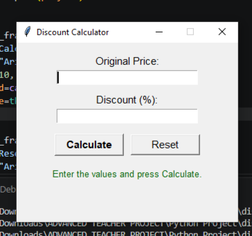

# Discount Calculator

A simple desktop application built with Python and Tkinter that calculates the discount amount and final price of a product.



## Features

- Enter an original price and a discount percentage
- Instantly calculates the discount amount and final price
- Input validation (no negative values, discount cannot exceed 100%)
- Error dialogs for invalid input
- Reset button to clear all fields

## Requirements

- Python 3.x (Tkinter is included in standard Python distributions)
- No third-party packages required

## Installation

1. Clone or download this repository.
2. (Optional) Create a virtual environment:

   ```bash
   python -m venv venv
   venv\Scripts\activate
   ```

3. Install dependencies (none required, but you can run):

   ```bash
   pip install -r requirements.txt
   ```

## Usage

Run the application:

```bash
python main.py
```

1. Enter the **Original Price**.
2. Enter the **Discount (%)**.
3. Click **Calculate** to see the discount amount and final price.
4. Click **Reset** to clear the fields.

## Project Structure

```
discount-calc-app/
├── main.py          # Application source code
├── requirements.txt # Python dependencies
├── README.md        # Project documentation
└── preview.png      # Application screenshot
```
